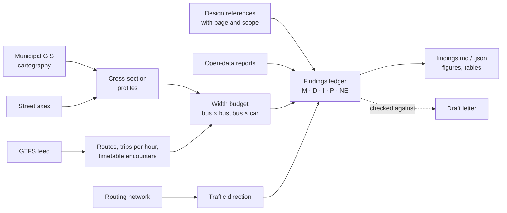

# mobilidados

*[Português](https://github.com/diogo4256/mobilidados/blob/main/README.md) · English*

**Mobility claims grounded in open data, in Portugal, starting with Lisbon.** mobilidados exists to improve
mobility, and public transport is part of the solution. Its tools measure how a street's space is shared out and
how much is left for people on foot, by bus or by bike. They turn the data that municipalities and operators
already publish into findings a public body can check for itself: every number
reproducible from its sources, and every statement graded by how well it is supported. A citizen, an
association, a journalist or a councillor can then make a request that rests on facts, not impressions.

The first tool answers one question: **does on-street parking leave room for buses to pass each other?** It
measures a street's cross-section from the municipality's own large-scale cartography, finds the bus routes
scheduled on it in the operator's GTFS feed, compares the free width that parking leaves with the vehicles that
must pass each other there and with published design references, and writes a **findings ledger**: every number,
its evidence grade, its sources and its caveats.

It started as one person's case about one street in Lisbon. The case is included in full as the worked example.


*Rua Ricardo Jorge (Lisbon): the mapped free width between the two parking strips against the width of the
vehicles scheduled to pass each other there. The figure is generated by the run; every number behind it, with
its grade and source, is in the [findings ledger](https://github.com/diogo4256/mobilidados/blob/main/cases/lisboa-rua-ricardo-jorge/results/findings.md).*

## Public data, with its provenance

Every input is a file or service that a public body or an operator makes available to anyone, without a login.
Each case records in `sources.lock.json` where every input came from, when, its SHA-256 and its licence, or
that the publisher states none; inputs without a stated licence are used but not redistributed. Anyone can
obtain the same files and check the same results.

## What it does



| Stage | Output |
| --- | --- |
| `profiles` | free width, parking strips, kerb-to-kerb, sidewalks at stations along the street; per-block summary |
| `direction` | one-way / two-way from the municipal routing network |
| `transit` | routes running along the street, heading, trips per hour on a service day, scheduled stop-to-stop times |
| `envelope` | margins for bus × bus, bus × car, car × car, with and without mirrors; overhang sensitivity; free width without the parking on one side or both |
| `encounters` | buses in opposite directions predicted to meet on the street, and where |
| `occurrences` | geolocated citizen reports per 100 m of street, compared with neighbouring streets |
| `area` | the streets with buses in the surrounding area where parking squeezes their passage in the same way |
| `standards` | measured width against design references, each with its page and scope |
| `ledger` | `findings.md` / `findings.json`: every statement with grade, sources, method and caveats |

## What it does not do (yet)

* It reads mapped areas, not parked cars; it uses the timetable, not observed operation; and it compares static
  widths, not swept paths. A narrow free width is a reason to ask for an inspection, not proof of an
  infraction. The ledger lists what was not verified (grade NE) for each case.
* Only Lisbon has a city profile. Other municipalities need one ([docs/adding-a-city.md](https://github.com/diogo4256/mobilidados/blob/main/docs/adding-a-city.md)).
* The room that parking leaves for buses is the only topic so far. Other mobility questions (sidewalks,
  crossings, stops, cycle lanes) are welcome as new tools that follow the same evidence standard.

## Evidence standard

Every statement in the ledger carries one grade ([docs/evidence-standard.md](https://github.com/diogo4256/mobilidados/blob/main/docs/evidence-standard.md)):

| Grade | Meaning |
| --- | --- |
| **M** | measured or counted from official data (cartography, GTFS, open data) |
| **D** | stated in an official document (law, manual, technical sheet), with page |
| **I** | inference from M/D/P (a model, a calculation) |
| **P** | assumption, stated as such (e.g. a mirror width no one publishes) |
| **NE** | not found / not verified, which is not the same as "does not exist" |

## Quick start

```bash
git clone https://github.com/diogo4256/mobilidados.git && cd mobilidados
uv sync                      # or: python -m venv .venv && .venv/bin/pip install -e .
uv run mobilidados fetch cases/lisboa-rua-ricardo-jorge     # downloads the sources, writes sources.lock.json
uv run mobilidados verify cases/lisboa-rua-ricardo-jorge    # checks each file against the lock (sha256)
uv run mobilidados run cases/lisboa-rua-ricardo-jorge       # writes results/
git diff --exit-code cases/lisboa-rua-ricardo-jorge/results/tables   # identical to the reference run?
```

Municipal services are live, so a fresh `fetch` can differ from the reference run: `verify` tells you which
files changed. A case pins its GTFS feed by SHA-256 and refuses to run on a different one unless you change
the pin on purpose; the Lisbon case downloads its feed from the Mobility Database archive, so the exact file
stays available. `mobilidados snapshot CASE DIR` copies the inputs whose licence allows redistribution into a
folder for archiving (e.g. on Zenodo); `mobilidados fetch CASE --from-dir DIR` restores them.

## AI-assisted tools (optional)

`pip install 'mobilidados[agents]'` adds three tools built on Claude. In all three, **the model proposes and
plain code verifies**: a model output never becomes evidence by itself. See [docs/ai-tools.md](https://github.com/diogo4256/mobilidados/blob/main/docs/ai-tools.md).

| Command | What the model does | What code then checks |
| --- | --- | --- |
| `mobilidados check-claims CASE draft.md` | an agent with search tools over the ledger and source texts extracts each claim in a draft letter and judges it | quotes must be verbatim in the cited source near the cited line; numbers must match the cited finding; anything in quotation marks must be a literal quote |
| `mobilidados extract-standard manual.pdf --pages N` | reads a manual page, including dimensions printed inside drawings | each value is looked for in the PDF text layer and in multi-pass OCR (Tesseract); sums are recomputed; unconfirmed values are flagged for a human, with the page image |
| `mobilidados discover --city X --start URL` | explores a municipality's GIS/open-data portal (allow-listed hosts, read-only) and proposes a city profile | every proposed layer is re-queried: fields exist, class codes occur in the test area |

`mobilidados lint draft.md` runs the deterministic part of the letter checks (generalisations, pre-emptive
concessions, quotation marks, "rule"/"minimum" for a recommendation) with no AI at all.

## Add your street

1. If your city already has a case, the street's name is enough:

   ```bash
   uv run mobilidados fetch cases/lisboa-rua-ricardo-jorge --only carris_gtfs   # once: the feed the case uses
   uv run mobilidados new-case "Rua Teixeira de Pascoais" --like cases/lisboa-rua-ricardo-jorge
   uv run mobilidados fetch cases/lisboa-rua-teixeira-de-pascoais
   uv run mobilidados run cases/lisboa-rua-teixeira-de-pascoais
   ```

   The name need not be spelled exactly: when no axis has that name, `new-case` looks for similar names and
   suggests them. It finds the street in the municipal axes layer, cuts it into blocks at the cross streets, finds the
   bus routes that run along it in the timetable and writes `case.toml`. Everything else (sources, feed,
   vehicles, parameters) comes from the `--like` case. The top of the file lists what to check before use.
2. If not, write a city profile: [docs/adding-a-city.md](https://github.com/diogo4256/mobilidados/blob/main/docs/adding-a-city.md) (`mobilidados discover` can draft it).

Method and limits: [docs/methodology.md](https://github.com/diogo4256/mobilidados/blob/main/docs/methodology.md). Writing to a public body with the results:
[docs/writing-to-public-bodies.md](https://github.com/diogo4256/mobilidados/blob/main/docs/writing-to-public-bodies.md).

## Repository layout

```text
src/mobilidados/          library and CLI (agents/ = optional AI tools)
src/mobilidados/data/     vehicle catalogue and design references (graded, with sources)
src/mobilidados/locales/  message catalogues for figures, ledger and reports, one file per language
cities/                   city profiles (services, class codes, licences, parameters) and dated data (feed, reports)
cases/<case>/             case.toml, sources.lock.json, results/ (committed), data/raw/ (not committed)
docs/                     evidence standard, methodology, AI tools, adding a city, writing to public bodies
tests/                    unit tests (synthetic data) and the case reproduction test
```

## Acknowledgements

To the bodies that publish the data this work rests on: the Câmara Municipal de Lisboa (cartography, street
axes, routing network and the Na Minha Rua reports), Carris (GTFS feed) and the
[Mobility Database](https://mobilitydatabase.org), which archives the feeds so that a past analysis can be
repeated.

## Contact

Diogo Adegas, <diogo.adegas@gmail.com> (also for code-of-conduct reports).

## Contributing, licence, citation

Contributions are welcome, especially new cities and cases: see [CONTRIBUTING.md](https://github.com/diogo4256/mobilidados/blob/main/CONTRIBUTING.md) and the
[code of conduct](https://github.com/diogo4256/mobilidados/blob/main/CODE_OF_CONDUCT.md). Code is under [Apache-2.0](https://github.com/diogo4256/mobilidados/blob/main/LICENSES/Apache-2.0.txt); documentation and
results under [CC-BY-4.0](https://github.com/diogo4256/mobilidados/blob/main/LICENSES/CC-BY-4.0.txt); third-party data keeps its own licence, recorded per
source in each case's `sources.lock.json` (see [REUSE.toml](https://github.com/diogo4256/mobilidados/blob/main/REUSE.toml)). Raw third-party data is not
redistributed here. To cite: [CITATION.cff](https://github.com/diogo4256/mobilidados/blob/main/CITATION.cff).
