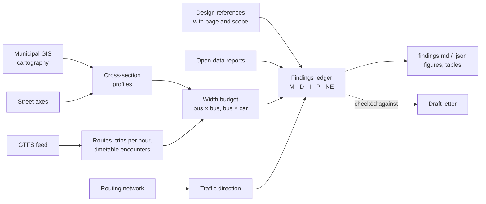

# streetfit

**Does the street fit the buses scheduled on it?** streetfit answers that with open data, reproducibly, and
with every statement graded by how well it is supported.

It measures a street's cross-section from the municipality's own large-scale cartography, finds the bus
routes scheduled on it in the operator's GTFS feed, compares the free width with the vehicles that must pass
each other there and with published design references, and writes a **findings ledger**: every number, its
evidence grade, its sources and its caveats. A citizen, a journalist or a councillor can then make a request
to the municipality that rests on facts the municipality can verify from its own data.

It started as one person's case about one street in Lisbon. The case is included in full as the worked example.


*Rua Ricardo Jorge (Lisbon): the mapped free width between the two parking strips against the width of the
vehicles scheduled to pass each other there. The figure is generated by the run; every number behind it, with
its grade and source, is in the [findings ledger](cases/lisboa-rua-ricardo-jorge/results/findings.md).*

## What it does



| Stage | Output |
| --- | --- |
| `profiles` | free width, parking strips, kerb-to-kerb, sidewalks at stations along the street; per-block summary |
| `direction` | one-way / two-way from the municipal routing network |
| `transit` | routes running along the street, heading, trips per hour on a service day, scheduled stop-to-stop times |
| `envelope` | margins for bus × bus, bus × car, car × car, with and without mirrors; overhang sensitivity |
| `encounters` | buses in opposite directions predicted to meet on the street, and where |
| `occurrences` | geolocated citizen reports per 100 m of street, compared with neighbouring streets |
| `area` | every street with buses in the surrounding area, scanned for the same pattern |
| `standards` | measured width against design references, each with its page and scope |
| `ledger` | `findings.md` / `findings.json`: every statement with grade, sources, method and caveats |

## Evidence standard

Every statement in the ledger carries one grade ([docs/evidence-standard.md](docs/evidence-standard.md)):

| Grade | Meaning |
| --- | --- |
| **M** | measured or counted from official data (cartography, GTFS, open data) |
| **D** | stated in an official document (law, manual, technical sheet), with page |
| **I** | inference from M/D/P (a model, a calculation) |
| **P** | assumption, stated as such (e.g. a mirror width no one publishes) |
| **NE** | not found / not verified, which is not the same as "does not exist" |

## Quick start

```bash
git clone <this repository> && cd streetfit
uv sync                      # or: python -m venv .venv && .venv/bin/pip install -e .
uv run streetfit fetch cases/lisboa-rua-ricardo-jorge     # downloads the sources, writes sources.lock.json
uv run streetfit verify cases/lisboa-rua-ricardo-jorge    # checks each file against the lock (sha256)
uv run streetfit run cases/lisboa-rua-ricardo-jorge       # writes results/
git diff --exit-code cases/lisboa-rua-ricardo-jorge/results/tables   # identical to the reference run?
```

Municipal services are live, so a fresh `fetch` can differ from the reference run: `verify` tells you which
files changed. A case pins its GTFS feed by SHA-256 and refuses to run on a different one unless you change
the pin on purpose; the Lisbon case downloads its feed from the Mobility Database archive, so the exact file
stays available. `streetfit snapshot CASE DIR` copies the inputs whose licence allows redistribution into a
folder for archiving (e.g. on Zenodo); `streetfit fetch CASE --from-dir DIR` restores them.

## AI-assisted tools (optional)

`pip install 'streetfit[agents]'` adds three tools built on Claude. In all three, **the model proposes and
plain code verifies**: a model output never becomes evidence by itself. See [docs/ai-tools.md](docs/ai-tools.md).

| Command | What the model does | What code then checks |
| --- | --- | --- |
| `streetfit check-claims CASE draft.md` | an agent with search tools over the ledger and source texts extracts each claim in a draft letter and judges it | quotes must be verbatim in the cited source near the cited line; numbers must match the cited finding; anything in quotation marks must be a literal quote |
| `streetfit extract-standard manual.pdf --pages N` | reads a manual page, including dimensions printed inside drawings | each value is looked for in the PDF text layer and in multi-pass OCR (Tesseract); sums are recomputed; unconfirmed values are flagged for a human, with the page image |
| `streetfit discover --city X --start URL` | explores a municipality's GIS/open-data portal (allow-listed hosts, read-only) and proposes a city profile | every proposed layer is re-queried: fields exist, class codes occur in the test area |

`streetfit lint draft.md` runs the deterministic part of the letter checks (generalisations, pre-emptive
concessions, quotation marks, "rule"/"minimum" for a recommendation) with no AI at all.

## Add your street

1. If your city already has a profile in [`cities/`](cities), copy
   [`cases/lisboa-rua-ricardo-jorge/case.toml`](cases/lisboa-rua-ricardo-jorge/case.toml), change the street
   name, envelope, blocks, routes and reference stops, then `fetch` and `run`.
2. If not, write a city profile: [docs/adding-a-city.md](docs/adding-a-city.md) (`streetfit discover` can draft it).

Method and limits: [docs/methodology.md](docs/methodology.md). Writing to a public body with the results:
[docs/writing-to-public-bodies.md](docs/writing-to-public-bodies.md).

## Limits

streetfit reads mapped areas, not parked cars; uses the timetable, not observed operation; and compares static
widths, not swept paths. A narrow free width is a reason to ask for an inspection, not proof of an infraction.
The ledger lists what was not verified (grade NE) for each case.

## Repository layout

```text
src/streetfit/          library and CLI (agents/ = optional AI tools)
src/streetfit/data/     vehicle catalogue and design references (graded, with sources)
src/streetfit/locales/  message catalogues for figures, ledger and reports, one file per language
cities/                 city profiles: services, class codes, licences
cases/<case>/           case.toml, sources.lock.json, results/ (committed), data/raw/ (not committed)
docs/                   evidence standard, methodology, AI tools, adding a city, writing to public bodies
tests/                  unit tests (synthetic data) and the case reproduction test
```

## Contact

Diogo Adegas, <diogo.adegas@gmail.com> (also for code-of-conduct reports).

## Contributing, licence, citation

Contributions are welcome, especially new cities and cases: see [CONTRIBUTING.md](CONTRIBUTING.md) and the
[code of conduct](CODE_OF_CONDUCT.md). Code is under [Apache-2.0](LICENSES/Apache-2.0.txt); documentation and
results under [CC-BY-4.0](LICENSES/CC-BY-4.0.txt); third-party data keeps its own licence, recorded per
source in each case's `sources.lock.json` (see [REUSE.toml](REUSE.toml)). Raw third-party data is not
redistributed here. To cite: [CITATION.cff](CITATION.cff).
