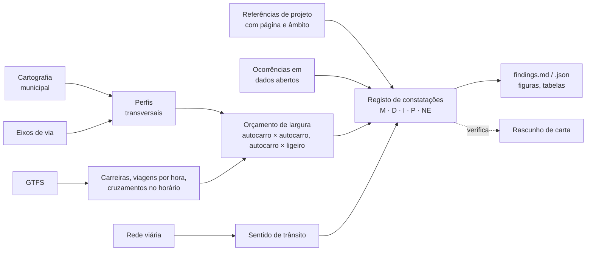

# mobilidados

*Português · [English](https://github.com/diogo4256/mobilidados/blob/main/README.en.md)*

**Reivindicações de mobilidade fundamentadas em dados abertos, em Portugal, a começar por Lisboa.** O
mobilidados transforma os dados que câmaras e operadores já publicam em constatações que uma entidade pública
pode verificar por si: cada número é reprodutível a partir das fontes e cada afirmação tem um grau de evidência.
Um cidadão, uma associação, um jornalista ou um vereador pode assim fazer um pedido assente em factos, não em
impressões.

A primeira ferramenta responde a uma pergunta: **a rua tem largura para os autocarros que lá passam?** Mede o
perfil transversal da rua na cartografia de grande escala da própria câmara, encontra no GTFS do operador as
carreiras que lá circulam, compara a faixa livre com os veículos que se têm de cruzar e com as referências de
projeto publicadas, e escreve um **registo de constatações**: cada número, o seu grau de evidência, as fontes e
as ressalvas.

Começou como o caso de uma pessoa sobre uma rua de Lisboa. O caso está incluído na íntegra como exemplo.


*Rua Ricardo Jorge (Lisboa): a faixa livre cartografada entre as duas faixas de estacionamento, comparada com a
largura dos veículos que ali se têm de cruzar. A figura é gerada pela execução; todos os números por trás dela,
com grau e fonte, estão no [registo de constatações](https://github.com/diogo4256/mobilidados/blob/main/cases/lisboa-rua-ricardo-jorge/results/findings.md).*

## Dados públicos, com proveniência

Cada dado de entrada é um ficheiro ou serviço que uma entidade pública ou um operador disponibiliza a qualquer
pessoa, sem autenticação. Cada caso regista em `sources.lock.json` de onde veio cada dado, quando, o seu SHA-256 e
a sua licença, ou que o editor não indica nenhuma; os dados sem licença indicada são usados mas não
redistribuídos. Qualquer pessoa pode obter os mesmos ficheiros e verificar os mesmos resultados.

## O que faz



| Etapa | Resultado |
| --- | --- |
| `profiles` | faixa livre, faixas de estacionamento, largura entre lancis e passeios ao longo da rua; resumo por quarteirão |
| `direction` | sentido único ou duplo, a partir da rede viária municipal |
| `transit` | carreiras que percorrem a rua, sentido, viagens por hora num dia de serviço, tempos entre paragens no horário |
| `envelope` | folgas para autocarro × autocarro, autocarro × ligeiro e ligeiro × ligeiro, com e sem espelhos; sensibilidade ao balanço |
| `encounters` | autocarros em sentidos opostos que, pelo horário, se cruzam na rua, e onde |
| `occurrences` | ocorrências georreferenciadas por 100 m de rua, comparadas com as ruas vizinhas |
| `area` | todas as ruas com autocarros na zona envolvente, analisadas para o mesmo padrão |
| `standards` | largura medida face às referências de projeto, cada uma com página e âmbito |
| `ledger` | `findings.md` / `findings.json`: cada afirmação com grau, fontes, método e ressalvas |

## O que (ainda) não faz

* Lê áreas cartografadas, não carros estacionados; usa o horário, não a operação observada; e compara larguras
  estáticas, não trajetórias de varrimento. Uma faixa livre estreita é razão para pedir uma vistoria, não prova
  de uma infração. O registo lista, para cada caso, o que não foi verificado (grau NE).
* Só Lisboa tem perfil de cidade. Outros municípios precisam de um ([docs/adding-a-city.md](https://github.com/diogo4256/mobilidados/blob/main/docs/adding-a-city.md)).
* Por agora, o único tema é a largura das ruas face ao tráfego de autocarros. Outras questões de mobilidade
  (passeios, atravessamentos, paragens, ciclovias) são bem-vindas como novas ferramentas, com o mesmo padrão de
  evidência.

## Padrão de evidência

Cada afirmação do registo tem um grau ([docs/evidence-standard.md](https://github.com/diogo4256/mobilidados/blob/main/docs/evidence-standard.md)):

| Grau | Significado |
| --- | --- |
| **M** | medido ou contado em dados oficiais (cartografia, GTFS, dados abertos) |
| **D** | escrito num documento oficial (lei, manual, ficha técnica), com página |
| **I** | inferência a partir de M/D/P (um modelo, um cálculo) |
| **P** | pressuposto, declarado como tal (por exemplo, uma largura de espelho que ninguém publica) |
| **NE** | não encontrado / não verificado, o que não é o mesmo que "não existe" |

## Começar

```bash
git clone https://github.com/diogo4256/mobilidados.git && cd mobilidados
uv sync                      # ou: python -m venv .venv && .venv/bin/pip install -e .
uv run mobilidados fetch cases/lisboa-rua-ricardo-jorge     # descarrega as fontes, escreve sources.lock.json
uv run mobilidados verify cases/lisboa-rua-ricardo-jorge    # confere cada ficheiro com o registo (sha256)
uv run mobilidados run cases/lisboa-rua-ricardo-jorge       # escreve results/
git diff --exit-code cases/lisboa-rua-ricardo-jorge/results/tables   # igual à execução de referência?
```

Os serviços municipais estão em produção, por isso um `fetch` novo pode diferir da execução de referência: o
`verify` diz que ficheiros mudaram. Um caso fixa o seu GTFS por SHA-256 e recusa correr com outro, a não ser que
se mude essa fixação de propósito; o caso de Lisboa descarrega o GTFS do arquivo da Mobility Database, para que o
ficheiro exato continue disponível. `mobilidados snapshot CASO PASTA` copia para uma pasta os dados cuja licença
permite redistribuição, para arquivo (por exemplo no Zenodo); `mobilidados fetch CASO --from-dir PASTA` repõe-nos.

## Ferramentas com IA (opcionais)

`pip install 'mobilidados[agents]'` acrescenta três ferramentas baseadas no Claude. Em todas, **o modelo propõe
e código simples verifica**: o que o modelo produz nunca se torna evidência por si só. Ver
[docs/ai-tools.md](https://github.com/diogo4256/mobilidados/blob/main/docs/ai-tools.md).

| Comando | O que o modelo faz | O que o código depois verifica |
| --- | --- | --- |
| `mobilidados check-claims CASO rascunho.md` | um agente com ferramentas de pesquisa no registo e nas fontes extrai cada afirmação de um rascunho de carta e avalia-a | as citações têm de estar textualmente na fonte, perto da linha indicada; os números têm de bater com a constatação citada; tudo o que está entre aspas tem de ser citação literal |
| `mobilidados extract-standard manual.pdf --pages N` | lê uma página de um manual, incluindo cotas impressas dentro dos desenhos | cada valor é procurado no texto do PDF e em OCR de várias passagens (Tesseract); as somas são recalculadas; os valores não confirmados ficam assinalados para uma pessoa, com a imagem da página |
| `mobilidados discover --city X --start URL` | explora o portal SIG / de dados abertos de um município (servidores autorizados, só leitura) e propõe um perfil de cidade | cada camada proposta é consultada de novo: os campos existem e os códigos de classe ocorrem na área de teste |

`mobilidados lint rascunho.md` faz a parte determinística das verificações de cartas (generalizações, concessões
antecipadas, aspas, "regra"/"mínimo" para uma recomendação), sem IA nenhuma.

## Juntar a sua rua

1. Se a sua cidade já tem perfil em [`cities/`](https://github.com/diogo4256/mobilidados/tree/main/cities), copie
   [`cases/lisboa-rua-ricardo-jorge/case.toml`](https://github.com/diogo4256/mobilidados/blob/main/cases/lisboa-rua-ricardo-jorge/case.toml), mude o nome da rua,
   o envelope, os quarteirões, as carreiras e as paragens de referência, e faça `fetch` e `run`.
2. Se não tem, escreva um perfil de cidade: [docs/adding-a-city.md](https://github.com/diogo4256/mobilidados/blob/main/docs/adding-a-city.md) (o `mobilidados discover` pode fazer um rascunho).

Método e limites: [docs/methodology.md](https://github.com/diogo4256/mobilidados/blob/main/docs/methodology.md). Escrever a uma entidade pública com os resultados:
[docs/writing-to-public-bodies.md](https://github.com/diogo4256/mobilidados/blob/main/docs/writing-to-public-bodies.md). A documentação
técnica está em inglês.

## Organização do repositório

```text
src/mobilidados/          biblioteca e linha de comandos (agents/ = ferramentas opcionais com IA)
src/mobilidados/data/     catálogo de veículos e referências de projeto (com grau e fonte)
src/mobilidados/locales/  textos das figuras, do registo e dos relatórios, um ficheiro por língua
cities/                   perfis de cidade: serviços, códigos de classe, licenças
cases/<caso>/             case.toml, sources.lock.json, results/ (no repositório), data/raw/ (fora dele)
docs/                     padrão de evidência, metodologia, ferramentas com IA, nova cidade, cartas a entidades
tests/                    testes unitários (dados sintéticos) e teste de reprodução dos casos
```

## Agradecimentos

Às entidades que publicam os dados em que este trabalho assenta: a Câmara Municipal de Lisboa (cartografia,
eixos de via, rede viária e as ocorrências Na Minha Rua), a Carris (GTFS) e a
[Mobility Database](https://mobilitydatabase.org), que arquiva os GTFS e permite repetir uma análise passada.

## Contacto

Diogo Adegas, <diogo.adegas@gmail.com> (também para questões do código de conduta).

## Contribuir, licença, citação

Contribuições são bem-vindas, sobretudo novas cidades e novos casos: ver [CONTRIBUTING.md](https://github.com/diogo4256/mobilidados/blob/main/CONTRIBUTING.md) e o
[código de conduta](https://github.com/diogo4256/mobilidados/blob/main/CODE_OF_CONDUCT.md). O código está sob [Apache-2.0](https://github.com/diogo4256/mobilidados/blob/main/LICENSES/Apache-2.0.txt); a documentação e os
resultados sob [CC-BY-4.0](https://github.com/diogo4256/mobilidados/blob/main/LICENSES/CC-BY-4.0.txt); os dados de terceiros mantêm a sua licença, registada por
fonte no `sources.lock.json` de cada caso (ver [REUSE.toml](https://github.com/diogo4256/mobilidados/blob/main/REUSE.toml)). Os dados brutos de terceiros não são
redistribuídos aqui. Para citar: [CITATION.cff](https://github.com/diogo4256/mobilidados/blob/main/CITATION.cff).
