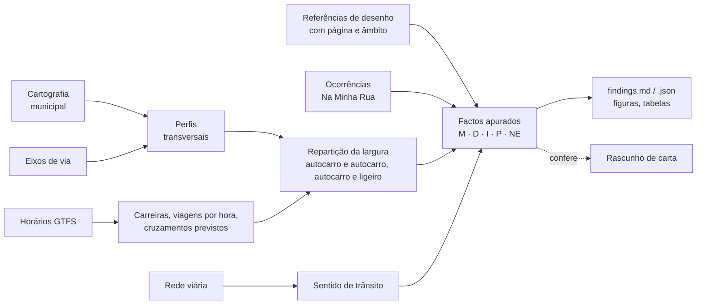

# mobilidados

*Português · [English](https://github.com/diogo4256/mobilidados/blob/main/README.en.md)*

**Ferramentas para reivindicações de mobilidade baseadas em dados, em Portugal, a começar por Lisboa.** O
mobilidados quer melhorar a forma como nos deslocamos na cidade, e o transporte público é parte da resposta.

Parte dos dados que as câmaras e os operadores já publicam e chega a factos que a própria Câmara pode confirmar:
cada número refaz-se a partir das fontes e cada afirmação diz em que se apoia. Assim, um morador, uma
associação, um jornalista ou um vereador pode levar um pedido à Câmara com factos, e não só com impressões.

A primeira ferramenta responde a uma pergunta: **o estacionamento deixa espaço para dois autocarros se cruzarem?**
Mede a rua de lado a lado na cartografia de pormenor da Câmara, vai ao horário publicado pelo operador (GTFS)
buscar as carreiras que lá passam, compara a largura que o estacionamento deixa livre com a largura dos veículos
que ali se cruzam e com as referências de desenho de rua publicadas, e reúne tudo numa **lista de factos
apurados**: cada número, em que se apoia, de onde vem e que reservas tem.

Nasceu de um caso concreto, uma rua de Lisboa, que está incluído na íntegra como exemplo.


*Rua Ricardo Jorge (Lisboa): a largura que fica livre entre o estacionamento dos dois lados, tal como está
cartografado, ao lado da largura dos veículos que ali se têm de cruzar. A figura sai da própria análise; todos
os números por trás dela, com a respetiva fonte, estão na [lista de factos apurados](https://github.com/diogo4256/mobilidados/blob/main/cases/lisboa-rua-ricardo-jorge/results/findings.md).*

## O que o exemplo mostra

Na Rua Ricardo Jorge, em Alvalade, a lista de factos apurados chega a isto:

* **[M]** Nos 116 m com estacionamento cartografado dos dois lados, a largura livre entre eles tem mediana de
  4,90 m.
* **[I]** Dois autocarros lado a lado ocupam pelo menos 5,00 m, só com a carroçaria e sem espaço nenhum entre
  eles: falta 0,10 m.
* **[D]** O manual de espaço público de Lisboa dá 6,80 m de referência entre as faixas de estacionamento de uma
  rua de dois sentidos com estacionamento dos dois lados (p. 152).
* **[I]** O horário da Carris prevê 6 a 7 encontros por dia entre autocarros em sentidos opostos nesta rua, 1 a 2
  deles nos troços com estacionamento dos dois lados.
* **[I]** Sem o estacionamento de um dos lados, a largura livre passaria a ter mediana de cerca de 6,9 m. Seriam
  retirados 116 m de estacionamento cartografado, cerca de 19 a 23 lugares.
* **[M]** Das 69 ruas da zona com autocarros no horário, só esta tem autocarros nos dois sentidos, dois sentidos
  de trânsito e estacionamento dos dois lados com menos de 5,5 m livres em pelo menos 30 m.

Cada linha leva a fonte, o método e as reservas na [lista completa](https://github.com/diogo4256/mobilidados/blob/main/cases/lisboa-rua-ricardo-jorge/results/findings.md),
incluindo o que não foi verificado: não há observação no local de dois autocarros a cruzar-se ali, e a Carris
não publica atrasos por rua.

## Para quem é, e o que não é

* **Moradores e associações:** levar à Câmara, à junta de freguesia ou à Carris um pedido sobre uma rua concreta,
  apoiado nos dados da própria Câmara, com o custo de cada opção dito tão claramente como o ganho.
* **Eleitos:** fazer uma pergunta ou uma recomendação que os serviços possam confirmar número a número.
* **Jornalistas:** verificar uma reivindicação antes de a publicar, com cada número ligado à sua fonte.
* **Serviços técnicos e operador:** passar em revista as ruas com autocarros de uma zona e ver onde o
  estacionamento aperta a passagem, antes de ir ao local.

Não é uma ferramenta de desenho de ruas: não propõe perfis, mede o que está cartografado. Não é um inventário de
estacionamento nem um mapa da repartição do espaço da cidade. Também não mede a velocidade nem os atrasos dos
autocarros, que pedem dados de operação que não são públicos por rua. Responde a uma pergunta sobre uma rua, a
partir dos dados oficiais, e diz em que se apoia cada número.

## De onde vêm os dados

Só se usam ficheiros e serviços a que qualquer pessoa pode aceder sem registo nem palavra-passe. No caso de Lisboa,
a cartografia, os eixos de via e as ocorrências Na Minha Rua vêm dos serviços de informação geográfica e do portal
de dados abertos da Câmara. O horário GTFS é uma cópia do ficheiro publicado pela Carris, guardada no arquivo da
Mobility Database, de onde é descarregado; essa cópia fica fixada pela impressão digital (SHA-256). O sentido de
trânsito é consultado num serviço do Lisboa Interativa, o visualizador de mapas que a Câmara disponibiliza ao
público, com acesso de convidado. Esse serviço não declara licença, e o seu endereço inclui a data de uma cópia de
segurança, pelo que pode mudar. Em cada caso, o ficheiro `sources.lock.json` guarda, para cada dado, o endereço, a
data em que foi obtido, a impressão digital (SHA-256) e a licença, ou a indicação de que o editor não declara
nenhuma. O que não tem licença declarada é usado, mas não é redistribuído. Quem quiser pode ir buscar os mesmos
ficheiros e confirmar os mesmos resultados.

## O que faz



| Etapa | O que produz |
| --- | --- |
| `profiles` | largura livre, estacionamento de cada lado, largura entre lancis e passeios ao longo da rua; resumo por quarteirão |
| `direction` | sentido único ou duplo, segundo a rede viária da Câmara |
| `transit` | carreiras que passam na rua, em que sentido, quantas viagens por hora num dia de serviço, tempos previstos entre paragens |
| `envelope` | folgas para dois autocarros, autocarro e ligeiro, e dois ligeiros, com e sem espelhos; efeito de carros estacionados que ficam fora do lugar; largura livre sem o estacionamento de um lado ou dos dois |
| `encounters` | autocarros em sentidos opostos que, segundo o horário, se cruzam na rua, e em que ponto |
| `occurrences` | ocorrências Na Minha Rua por cada 100 m de rua, comparadas com as ruas vizinhas |
| `area` | ruas com autocarros na zona à volta onde o estacionamento aperta a passagem da mesma maneira |
| `standards` | largura medida comparada com as referências de desenho de rua, cada uma com página e âmbito |
| `ledger` | `findings.md` / `findings.json`: cada afirmação com a sua base, fontes, método e reservas |

## O que (ainda) não faz

* Lê os lugares de estacionamento desenhados na cartografia, não os carros que lá estão; usa o horário, não o
  que os autocarros fazem na realidade; e compara larguras, sem simular o espaço que um autocarro varre numa
  curva. Uma rua estreita é motivo para pedir uma vistoria, não prova de que há uma infração. Para cada caso, a
  lista de factos diz o que ficou por verificar (NE).
* Por agora só há perfil de cidade para Lisboa. Os outros concelhos precisam do seu ([docs/adding-a-city.md](https://github.com/diogo4256/mobilidados/blob/main/docs/adding-a-city.md)).
* Por agora só trata do espaço que o estacionamento deixa aos autocarros. Outras questões de mobilidade
  (passeios, passadeiras, paragens, ciclovias) são bem-vindas como novas ferramentas, com o mesmo rigor.

## Em que se apoia cada afirmação

Cada facto da lista traz uma letra que diz em que se apoia ([docs/evidence-standard.md](https://github.com/diogo4256/mobilidados/blob/main/docs/evidence-standard.md)):

| Letra | Quer dizer |
| --- | --- |
| **M** | medido ou contado em dados oficiais (cartografia, horários, dados abertos) |
| **D** | escrito num documento oficial (lei, manual, ficha técnica), com a página |
| **I** | inferido a partir de M, D ou P (um modelo, uma conta) |
| **P** | pressuposto, assumido como tal (por exemplo, a largura com espelhos, que ninguém publica) |
| **NE** | não encontrado ou não verificado, o que não quer dizer que não exista |

## Como usar

```bash
git clone https://github.com/diogo4256/mobilidados.git && cd mobilidados
uv sync                      # ou: python -m venv .venv && .venv/bin/pip install -e .
uv run mobilidados fetch cases/lisboa-rua-ricardo-jorge     # descarrega as fontes e escreve sources.lock.json
uv run mobilidados verify cases/lisboa-rua-ricardo-jorge    # confere cada ficheiro com a impressão digital guardada
uv run mobilidados run cases/lisboa-rua-ricardo-jorge       # escreve os resultados em results/
git diff --exit-code cases/lisboa-rua-ricardo-jorge/results/tables   # dá o mesmo que a análise de referência?
```

Os serviços da Câmara vão sendo atualizados, por isso um `fetch` feito hoje pode não dar exatamente o mesmo que
a análise de referência; o `verify` diz que ficheiros mudaram. Cada caso fixa o horário GTFS que usou, pela
impressão digital, e recusa correr com outro, a não ser que se mude isso de propósito. No caso de Lisboa, o
horário vem do arquivo da Mobility Database, onde o ficheiro exato continua disponível. `mobilidados snapshot
CASO PASTA` copia para uma pasta os dados que a licença deixa redistribuir, para os guardar (por exemplo no
Zenodo); `mobilidados fetch CASO --from-dir PASTA` volta a pô-los no sítio.

## Ferramentas com IA (opcionais)

`pip install 'mobilidados[agents]'` acrescenta as ferramentas da tabela abaixo, que usam o Claude. Em todas, **o
modelo propõe e o código confirma**: nada do que o modelo diz passa a contar como prova por si só. Mais pormenores
em [docs/ai-tools.md](https://github.com/diogo4256/mobilidados/blob/main/docs/ai-tools.md).

| Comando | O que o modelo faz | O que o código confirma a seguir |
| --- | --- | --- |
| `mobilidados check-claims CASO rascunho.md` | lê um rascunho de carta, separa cada afirmação e procura-a na lista de factos e nas fontes | as citações têm de estar tal e qual na fonte, perto da linha indicada; os números têm de bater com o facto citado; o que está entre aspas tem de ser citação literal |
| `mobilidados extract-standard manual.pdf --pages N` | lê uma página de um manual, incluindo as cotas dos desenhos | cada valor é procurado no texto do PDF e por reconhecimento ótico de caracteres (Tesseract), em várias passagens; as somas são refeitas; o que não se confirma fica marcado para uma pessoa ver, com a imagem da página |
| `mobilidados discover --city X --start URL` | percorre o portal de cartografia ou de dados abertos de um município (só endereços autorizados, só leitura) e propõe um perfil de cidade | cada camada proposta é consultada outra vez: os campos existem e os códigos aparecem mesmo na zona de teste |

`mobilidados lint rascunho.md` faz, sem IA nenhuma, as verificações automáticas de uma carta: generalizações,
concessões feitas à partida, aspas, e palavras como "norma", "regra" ou "obrigatório" usadas para o que é só uma
recomendação.

## Analisar a sua rua

1. Se a sua cidade já tem um caso, basta o nome da rua:

   ```bash
   uv run mobilidados fetch cases/lisboa-rua-ricardo-jorge --only carris_gtfs   # uma vez: o horário que o caso usa
   uv run mobilidados new-case "Rua Teixeira de Pascoais" --like cases/lisboa-rua-ricardo-jorge
   uv run mobilidados fetch cases/lisboa-rua-teixeira-de-pascoais
   uv run mobilidados run cases/lisboa-rua-teixeira-de-pascoais
   ```

   O nome não tem de estar escrito tal e qual: se não houver um eixo com esse nome, o `new-case` procura nomes
   parecidos e sugere-os. O `new-case` encontra a rua na cartografia da Câmara, divide-a em quarteirões nos cruzamentos, vai ao horário
   buscar as carreiras que lá passam e escreve o `case.toml`. O resto (fontes, horário, veículos, parâmetros) vem
   do caso indicado em `--like`. No topo do ficheiro fica a lista do que tem de confirmar antes de usar.
2. Se não tem, comece pelo perfil da cidade: [docs/adding-a-city.md](https://github.com/diogo4256/mobilidados/blob/main/docs/adding-a-city.md) (o `mobilidados discover` pode fazer um primeiro rascunho).

O método e os seus limites estão em [docs/methodology.md](https://github.com/diogo4256/mobilidados/blob/main/docs/methodology.md); conselhos para escrever à
Câmara ou a outra entidade com estes resultados, em [docs/writing-to-public-bodies.md](https://github.com/diogo4256/mobilidados/blob/main/docs/writing-to-public-bodies.md).
A documentação técnica está, por agora, em inglês.

## Organização do repositório

```text
src/mobilidados/          biblioteca e comandos (agents/ = ferramentas opcionais com IA)
src/mobilidados/data/     catálogo de veículos e de referências de desenho de rua, com fonte
src/mobilidados/locales/  textos das figuras, da lista de factos e dos relatórios, um ficheiro por língua
cities/                   perfis de cidade (serviços, códigos, licenças, parâmetros) e dados datados (horário, ocorrências)
cases/<caso>/             case.toml, sources.lock.json, results/ (no repositório), data/raw/ (fora dele)
docs/                     método, ferramentas com IA, nova cidade, cartas a entidades públicas, partes interessadas
tests/                    testes com dados fictícios e teste que refaz cada caso
```

## Agradecimentos

Às entidades que publicam os dados em que este trabalho assenta: a Câmara Municipal de Lisboa (cartografia,
eixos de via, rede viária e ocorrências Na Minha Rua), a Carris (horários GTFS) e a
[Mobility Database](https://mobilitydatabase.org), que guarda os horários antigos e permite repetir uma análise
feita no passado.

## Contacto

Diogo Adegas, <diogo.adegas@gmail.com> (também para questões do código de conduta).

## Contribuir, licença, citação

Todas as contribuições são bem-vindas, sobretudo novas cidades e novos casos: ver [CONTRIBUTING.md](https://github.com/diogo4256/mobilidados/blob/main/CONTRIBUTING.md) e o
[código de conduta](https://github.com/diogo4256/mobilidados/blob/main/CODE_OF_CONDUCT.md). O código está sob a licença [Apache-2.0](https://github.com/diogo4256/mobilidados/blob/main/LICENSES/Apache-2.0.txt); a documentação e os
resultados, sob [CC-BY-4.0](https://github.com/diogo4256/mobilidados/blob/main/LICENSES/CC-BY-4.0.txt). Os dados de terceiros mantêm a licença de origem, registada
para cada fonte no `sources.lock.json` do caso (ver [REUSE.toml](https://github.com/diogo4256/mobilidados/blob/main/REUSE.toml)), e os ficheiros originais não são
redistribuídos aqui. Para citar o projeto: [CITATION.cff](https://github.com/diogo4256/mobilidados/blob/main/CITATION.cff).
