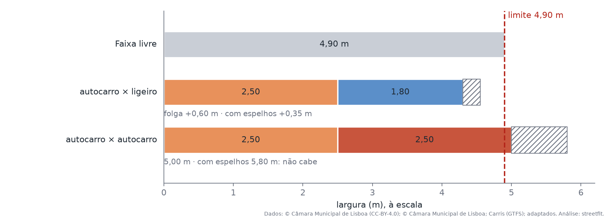
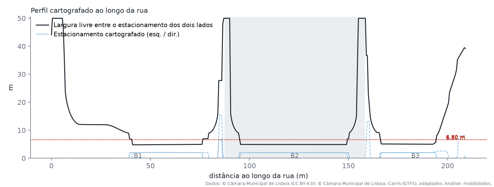
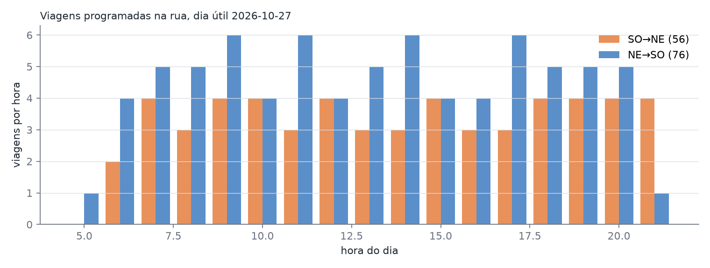
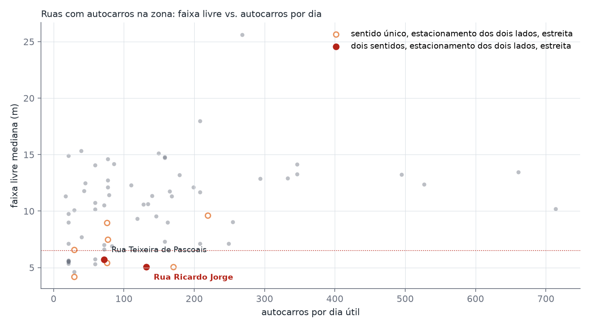

# Rua Ricardo Jorge (Alvalade, Lisboa)

**Question:** with parking on both sides, does the remaining free width let two scheduled buses pass each
other in opposite directions?

**Pergunta:** com estacionamento dos dois lados, a faixa livre que sobra permite que dois autocarros
programados se cruzem em sentidos opostos?

## Results

Every result, with its evidence grade, sources, method and caveats, is in the findings ledger that the run
generates: [results/findings.md](results/findings.md) (Portuguese) and [results/findings.json](results/findings.json).
The tables behind it are in [results/tables](results/tables). The figures below are generated by the same run.









## Reproduce

```bash
mobilidados fetch cases/lisboa-rua-ricardo-jorge
mobilidados verify cases/lisboa-rua-ricardo-jorge
mobilidados run cases/lisboa-rua-ricardo-jorge
```

Every input can be obtained by anyone and checked against `sources.lock.json`, which records what was
retrieved, from where and when:

* **GTFS:** the Carris endpoint only serves the current feed. The case pins the feed it used
  (`sources.carris_gtfs.sha256` in `cities/lisboa-2026-10.toml`, the dated Lisbon data the case extends) and
  downloads it from the
  [Mobility Database](https://mobilitydatabase.org/feeds/gtfs/mdb-2929) archive, so the exact file stays
  available.
* **CML cartography and street axes:** fetched live. If the CML updates them, `verify` reports which files
  changed, and the results may change with them.
* **Na Minha Rua occurrences** (CC-BY): fetched live from dados.cm-lisboa.pt. `mobilidados snapshot` can package
  these and the cartography (both CC-BY) for an archive.
* **Routing-network answers** (traffic direction): queried from the services behind the Lisboa Interativa
  public viewer, in guest access, and cached in `data/raw/*identify.json` during the first run. The service
  address embeds a backup date and may change (see `source_templates.lxi_network_identify` in
  `cities/lisboa.toml`).

## Provenance of this case

This analysis was first done with standalone scripts and then rebuilt as this toolset (then called streetfit). The
rebuild was checked to reproduce the original outputs exactly, and `test_results_reproduce` (in
`tests/test_cases.py`) now re-runs the case and fails if any committed table or finding changes. Two things were
fixed on the way: two summary tables used by the original dossier had no script producing them (they are now
generated), and the occurrences filter had drifted to also count bike-parking requests as abusive parking. The case
uses an anchored category filter (`occurrences.filters` in `cities/lisboa.toml`, shared by every Lisbon case),
which reproduces the figure originally reported.

## Not verified (NE)

The ledger lists what could not be verified (grade NE), from `known_gaps`: this street's in `case.toml`, then
those every Lisbon case shares in `cities/lisboa.toml`.

## Configuration

`case.toml` sets the street and what is specific to it. The method parameters that every Lisbon case shares,
the vehicles and the design references compared are in `cities/lisboa.toml`; the GTFS feed, its service day and
the Na Minha Rua files are in `cities/lisboa-2026-10.toml`. The run records the resolved configuration it used
in [results/config.json](results/config.json).
