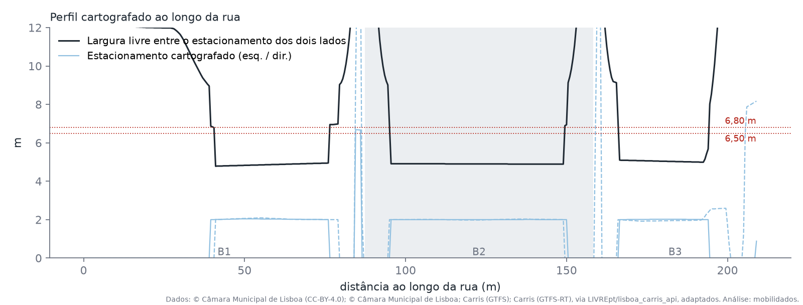
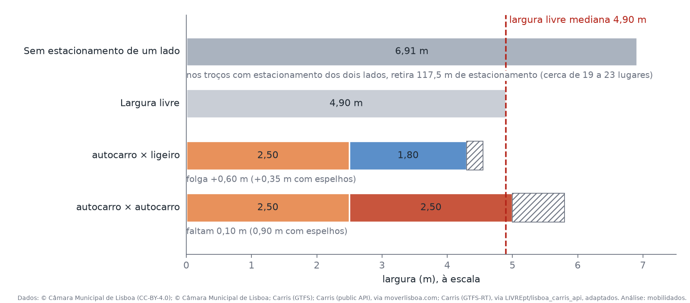
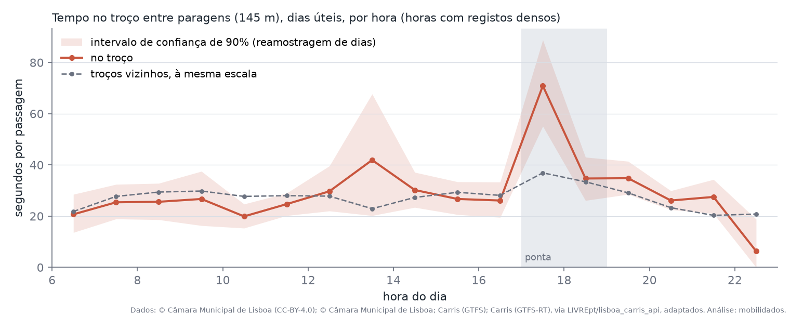

# Rua Ricardo Jorge (Alvalade): espaço para os autocarros se cruzarem

*Versão de 2026-11-15.*

**Dossier técnico a partir de dados públicos.** Cada número vem da lista de factos apurados do caso
([results/findings.md](results/findings.md)), indicada entre parênteses retos com a letra que diz em que se apoia:
**M** medido em dados oficiais, **D** escrito em documento oficial, **I** inferido desses dados, **P** pressuposto.
Todos os números se refazem a partir das fontes com o `mobilidados`; o anexo B diz como.

## Resumo

Na Rua Ricardo Jorge passam autocarros da Carris nos dois sentidos. Onde há estacionamento dos dois lados, a faixa
que fica livre entre os carros estacionados é 1,90 m mais estreita do que o perfil de referência do manual de espaço
público da própria Câmara para este tipo de rua, e mais estreita do que a largura de dois autocarros com espelhos.
Na zona à volta, é a única rua com autocarros nos dois sentidos nesta situação.

- **4,90 m** de largura livre mediana, nos 117,5 m da rua com estacionamento cartografado dos dois lados. [M `free_width`]
- **6,80 m** é o perfil de referência da Câmara para uma rua de dois sentidos com estacionamento dos dois lados
  (Manual de espaço público, p. 152): faltam 1,90 m. [D `standard_cml_manual_two_way_profile`]
- **5,00 m** ocupam dois autocarros lado a lado só com a carroçaria, e 5,80 m com espelhos. Mesmo admitindo um erro
  de 0,30 m em cada aresta da cartografia a favor da rua, a largura livre seria de 5,50 m: ainda abaixo dos 5,80 m.
  [I `width_budget`, `width_accuracy`]
- **6–7 encontros por dia** entre autocarros em sentidos opostos nesta rua, segundo o horário; 4–5 deles entre dois
  autocarros da carreira 744. [I `encounters`]
- **+49%** de tempo no troço entre paragens, às 17h–19h dos dias úteis, face ao que o abrandamento dos troços vizinhos
  explicaria (posições GPS arquivadas). Claro em 2025; não confirmado em 2026, com muito menos dados. [I `delay`]
- **A opção medida:** sem o estacionamento de um dos lados nesses 117,5 m, a largura livre passaria a ter mediana de
  6,91 m. Custaria 117,5 m de estacionamento cartografado, cerca de 19 a 23 lugares. [I `without_parking`, `parking_removed`]

**Pedido à Câmara:** que os serviços confirmem estas larguras no local, nos três pontos do anexo A, e avaliem o perfil
da rua para que os autocarros que ali circulam se possam cruzar, informando da decisão tomada.

## 1. A rua e os autocarros

A rua tem 209,25 m de eixo [M `length`] e, segundo a rede viária da Câmara, dois sentidos de trânsito em 8 de 8 pontos
verificados [M `traffic`]. Segundo o horário da Carris, passam as carreiras 744 e 46B: num dia útil (2026-10-27),
56 viagens SO→NE e 76 viagens NE→SO, no máximo 4 e 6 por hora [M `transit`]. A 744 percorre a rua nos dois sentidos.

O veículo de referência é o autocarro standard de 12 m da Carris, com 2,50 m de carroçaria; os 12 modelos de
autocarro standard que a Carris publica têm 2,5 a 2,6 m de largura, pelo que este é o mais estreito
[D `vehicle_carris_man_city_gold_body`]. Nas posições GPS arquivadas no troço, a carreira 744 aparece sobretudo com
veículos de números 26xx (79% das posições, 64 veículos), a série do veículo de referência (2643) [M `fleet`].

## 2. A largura que o estacionamento deixa



Medida na cartografia municipal de pormenor, em perfis transversais a cada 0,5 m, a largura livre entre as duas faixas
de estacionamento vai de 4,78 a 5,68 m, com mediana de 4,90 m, nos 117,5 m com estacionamento dos dois lados
[M `free_width`]. Cada faixa de estacionamento ocupa 2,01 m (mediana) [M `parking_strips`]. Em 77% dos perfis contados,
a largura livre fica abaixo dos 5,00 m que ocupam duas carroçarias de autocarro [I `width_budget`].

| Termo de comparação | Largura | Diferença face aos 4,90 m | Base |
| --- | ---: | ---: | --- |
| Perfil de referência da Câmara, rua de dois sentidos com estacionamento dos dois lados (Manual de espaço público, p. 152) | 6,80 m | −1,90 m | D: recomendação municipal |
| Faixa para o cruzamento de dois autocarros de carreira (RASt 06, diretriz alemã, citada pelo Senado de Berlim) | 6,50 m | −1,60 m | D: referência estrangeira, não é lei portuguesa |
| Dois autocarros, com espelhos | 5,80 m | −0,90 m | I, com a largura dos espelhos pressuposta (P) |
| Dois autocarros, só a carroçaria, sem espaço nenhum entre eles | 5,00 m | −0,10 m | I |
| Um autocarro e um ligeiro, só a carroçaria | 4,30 m | +0,60 m | I, com a largura do ligeiro pressuposta (P) |



**O que resiste ao erro da cartografia.** Admitindo 0,30 m de erro em cada aresta cartografada, a favor da rua, a
largura livre mediana seria de 5,50 m: ainda 0,30 m abaixo dos 5,80 m de dois autocarros com espelhos, e 1,30 m abaixo
dos 6,80 m do perfil de referência da Câmara [I `width_accuracy`]. A diferença só com a carroçaria (−0,10 m) fica
dentro dessa margem e não é usada sozinha. A comparação admite que os carros estacionados ficam dentro das faixas
cartografadas; se saírem delas, a largura livre é menor [I `width_budget`].

## 3. Com que frequência, e com que efeito

Segundo o horário de 2026-10-27, há 6–7 encontros por dia entre autocarros em sentidos opostos nesta rua (a 15 ou
20 km/h constantes); 1–2 acontecem nos troços com estacionamento dos dois lados. Por pares de carreiras: 744 × 744,
4–5; 744 × 46B, 2 [I `encounters`]. São estimativas do horário, não encontros observados.



As posições GPS dos autocarros arquivadas entre 2025-02-17 e 2026-11-13 (437 dias úteis) mostram que, às 17h–19h, o
troço entre as paragens da rua (145 m) leva mais 49% de tempo do que o abrandamento dos troços vizinhos das mesmas
carreiras faria esperar (intervalo de confiança de 90%: +34% a +65%). Em 2025, +60% (+42% a +80%); em 2026, +4%
(−17% a +31%), com muito menos posições, o que não confirma o excesso nesse ano [I `delay`]. Nas horas bem cobertas
pelo arquivo, são mais 14 s por passagem (6 a 24 s) [I `delay_seconds`]. Estes dados dizem onde se perde o tempo, não
porquê, e vêm de um arquivo do feed em tempo real da Carris mantido por terceiros, não do registo da própria Carris.

## 4. Na zona

Das 69 ruas da zona com autocarros no horário, 2 têm dois sentidos e estacionamento dos dois lados com menos de 5,5 m
de largura livre em pelo menos 30 m (Rua Ricardo Jorge e Rua Teixeira de Pascoais); destas, só a Rua Ricardo Jorge tem
autocarros nos dois sentidos [M `area_pattern`]. Nas outras ruas da zona com autocarros, esta combinação não se repete.

## 5. A opção medida, e o que custa

Sem o estacionamento do lado NO nos troços com estacionamento dos dois lados, a largura livre passaria a ter mediana
de 6,91 m; sem o do lado SE, 6,92 m. Dois autocarros teriam uma folga de +1,91 m (+1,11 m com espelhos)
[I `without_parking`]. Isso retiraria 117,5 m de estacionamento cartografado, cerca de 19 a 23 lugares, contados a
5,00–6,00 m cada (pressuposto); em toda a rua, o estacionamento cartografado mede 122,5 m do lado NO e 137,0 m do lado
SE [I `parking_removed`]. É uma opção medida, não um projeto: o desenho da rua cabe aos serviços.

## 6. O que estes dados não mostram, e como se supre

Nada disto exige observação no local por quem escreve: o que os dados públicos não cobrem, pede-se a quem o tem.

| O que falta | Porque importa | Como se supre |
| --- | --- | --- |
| A medição vem da cartografia (fotogrametria de 2016, completagem de campo em 2020), não do local | Uma marcação pode ter mudado | Os serviços medem nos três pontos do anexo A |
| Os encontros vêm do horário; o arquivo GPS regista cada autocarro de poucos em poucos minutos, e um autocarro atravessa o troço em menos de um minuto (27 s fora da ponta, 48 s na ponta) | Não há registo de encontros reais | Pedir à Carris os registos do seu sistema de apoio à exploração para o troço |
| A largura dos autocarros com espelhos não é publicada (aqui, 2,90 m, pressuposto) | A comparação com espelhos depende dela | Pedir à Carris a largura com espelhos dos veículos das carreiras 744 e 46B |
| A Carris não publica que modelos correspondem a que números de frota; a 46B aparece só com veículos de números 2xx | Se forem mais pequenos, os encontros 744 × 46B pedem menos largura; o caso assenta nos encontros 744 × 744 | Pedir à Carris os modelos das séries 26xx e 2xx |
| O tempo perdido não tem causa atribuída, e 2026 tem poucos dados | Estacionamento, autocarros em sentido contrário ou um semáforo podem contribuir | Pedir à Carris os tempos de percurso e as ocorrências registadas na rua |
| Não se sabe quando nem com que fundamento o estacionamento foi marcado dos dois lados | Saber se o perfil atual foi decidido tendo os autocarros em conta | Pedir à Câmara o projeto ou a deliberação (Lei n.º 26/2016) |

Os pedidos de documentos fazem-se por escrito ao abrigo da Lei n.º 26/2016, de 22 de agosto (artigos 12.º e 15.º),
que dá à entidade 10 dias para responder; o `mobilidados draft --ask documents` escreve o pedido.

## Anexo A: pontos de verificação

Pontos ao longo do eixo da rua (s: distância desde a Av. do Rio de Janeiro) onde os serviços podem medir a largura
livre no local ([results/tables/check_points.csv](results/tables/check_points.csv)):

| s | Quarteirão | Coordenadas (lat, lon) | Largura livre cartografada |
| ---: | --- | --- | ---: |
| 60 m | B1 (Av. do Rio de Janeiro → R. Cor. Marques Leitão) | 38.756950, −9.139441 | 4,87 m |
| 122 m | B2 (R. Cor. Marques Leitão → R. Constantino Fernandes) | 38.757165, −9.138783 | 4,90 m |
| 180 m | B3 (R. Constantino Fernandes → R. Carlos Mayer) | 38.757363, −9.138165 | 5,04 m |

## Anexo B: fontes e reprodução

- Cartografia municipal vetorial 1:1000, eixos de via e rede viária: Câmara Municipal de Lisboa (CC BY 4.0, exceto a
  rede viária do Lisboa Interativa, sem licença declarada).
- Horário GTFS da Carris, cópia arquivada na Mobility Database e fixada pela impressão digital SHA-256.
- Posições em tempo real da Carris arquivadas por terceiros (LIVREpt/lisboa_carris_api), fixadas num commit.
- Lisboa: o Desenho da Rua – Manual de espaço público (Câmara Municipal de Lisboa, 2018), p. 152.
- Fichas da frota da Carris (carris.pt › Descubra › Frota), consultadas em 2026-11-15.

Cada ficheiro, a data em que foi obtido, a licença e a impressão digital estão em
[sources.lock.json](sources.lock.json). Para refazer tudo:

```bash
git clone https://github.com/diogo4256/mobilidados.git && cd mobilidados && uv sync
uv run mobilidados fetch cases/lisboa-rua-ricardo-jorge
uv run mobilidados run cases/lisboa-rua-ricardo-jorge
```

A lista completa de factos, com o método e as reservas de cada um, está em [results/findings.md](results/findings.md).
